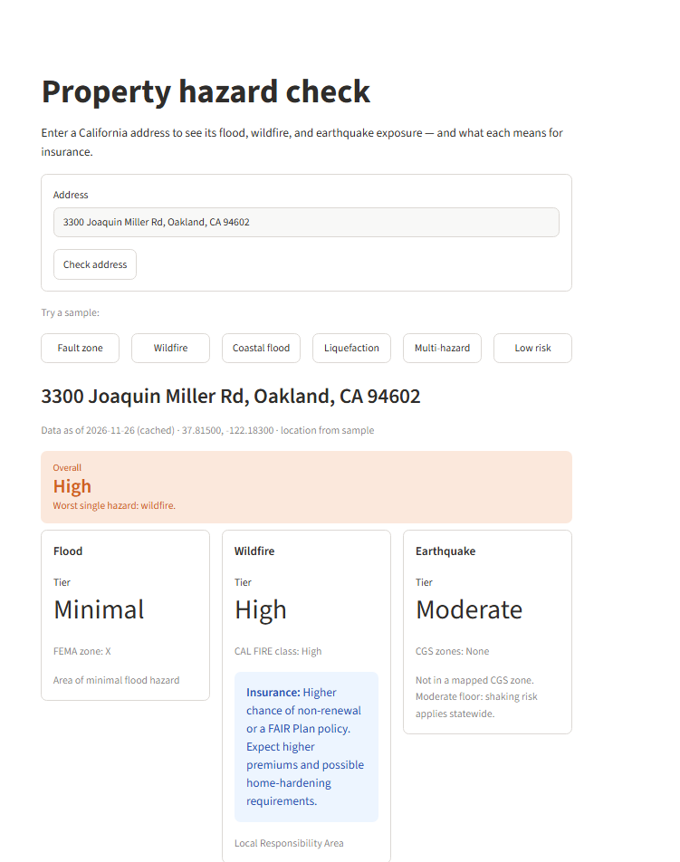

# Property Hazard Check

Enter a California address and get a one-page report on its **flood, wildfire, and earthquake** exposure — plus what each hazard means for insurance.

> **Status:** MVP live. See the [project board](../../projects) and [milestones](../../milestones).

> **Not insurance advice.** Results come from public hazard maps. Insurers use their own models.

**Live app:** https://property-hazard-check.streamlit.app/

<!-- TODO (Brian): screenshots — desktop report (Fault zone sample) and mobile view -->
<!--  -->

## The problem

California homebuyers often learn about flood, wildfire, or earthquake exposure late — at the insurance quote or in the disclosure packet, sometimes after an offer is in. Insurers have pulled back from high-risk areas, so a property's hazard zones can decide whether it's insurable at a normal price. The public hazard maps that drive these rules are free, but they're spread across three agencies, each with its own map viewer.

This app puts them in one place: enter an address, get one page with each hazard's tier, the official zone code, and what it means for insurance.

<!-- TODO (Brian): case study — why you built this, the hardest decision, what you'd do next -->

## Run locally

```bash
pip install -r requirements.txt
streamlit run app.py
```

## How it works

1. **Geocode** the address to a point (US Census Geocoder).
2. **Check the cache** — sample addresses are served from a baseline cache.
3. **Look up hazard zones** at that point from public data sources.
4. **Score** each hazard (Minimal / Moderate / High / Severe) and roll up to an overall tier.
5. **Report** the tiers, raw zone codes, and insurance implications.

## Data sources

| Hazard | Source | Notes |
|---|---|---|
| Geocoding | US Census Geocoder | Free, no API key |
| Flood | FEMA National Flood Hazard Layer (NFHL) | Flood zone codes (A, AE, V, X…) |
| Wildfire | CAL FIRE Fire Hazard Severity Zones (2025) | Moderate / High / Very High |
| Earthquake | California Geological Survey (CGS) | Alquist-Priolo fault zones, liquefaction, landslide zones |

Endpoints live in [`config/sources.yaml`](config/sources.yaml). Publisher, update dates, key fields, and known limits for each source: [`docs/data_sources.md`](docs/data_sources.md).

## Scoring

Rules live in [`config/scoring_rules.yaml`](config/scoring_rules.yaml) — versioned, and shown on every report.

- **Overall tier = worst single hazard** (one severe hazard is enough to cause insurance trouble) — only when every hazard has a tier. Otherwise the overall is **No Score** (insufficient data); no guessing.
- **Compound flag** when 2+ hazards are High or above (scored reports only).
- **No data is never Minimal.** Two labels, kept separate:
  - **Not mapped** — the source has no class at this point (e.g. no CAL FIRE polygon, FEMA zone D). CAL FIRE "NonWildland" counts as Minimal.
  - **Unknown** — the lookup failed.
  Either one means the overall is **No Score**.
- Earthquake has a **Moderate floor**: CGS zones map ground failure, not shaking.

## Sample addresses

Public places used for demos and tests: [`data/sample_addresses.csv`](data/sample_addresses.csv).

## Reliability

- Baseline cache for sample addresses ([`data/cache.json`](data/cache.json)), so demos work even if a source is down. Entries never expire; refresh by hand with the **Build cache** workflow (Actions tab → Run workflow).
- Daily health check via GitHub Actions; alerts on failure.
- Every report shows "Data as of …" — the cache date for cached results, today's date for live lookups.

## Limitations

- California only.
- Geocoded points are estimated along the street, not at the parcel; near a zone boundary the result can be wrong.
- Regulatory maps show where rules apply, not every place that can flood, burn, or fail in an earthquake.
- Live lookups can be slow or fail when a public source is down; that hazard then shows as Unknown with a link to the official map.
- Free hosting: the app sleeps after a period with no visitors, and the first visit after that has to wake it.
- Public hazard zones ≠ insurer risk models.
- 2025 local fire zones were adopted by cities on different dates.

## Roadmap (post-MVP)

- dbt + BigQuery pipeline replacing live lookups
- Historical wildfire perimeters
- Side-by-side address comparison
